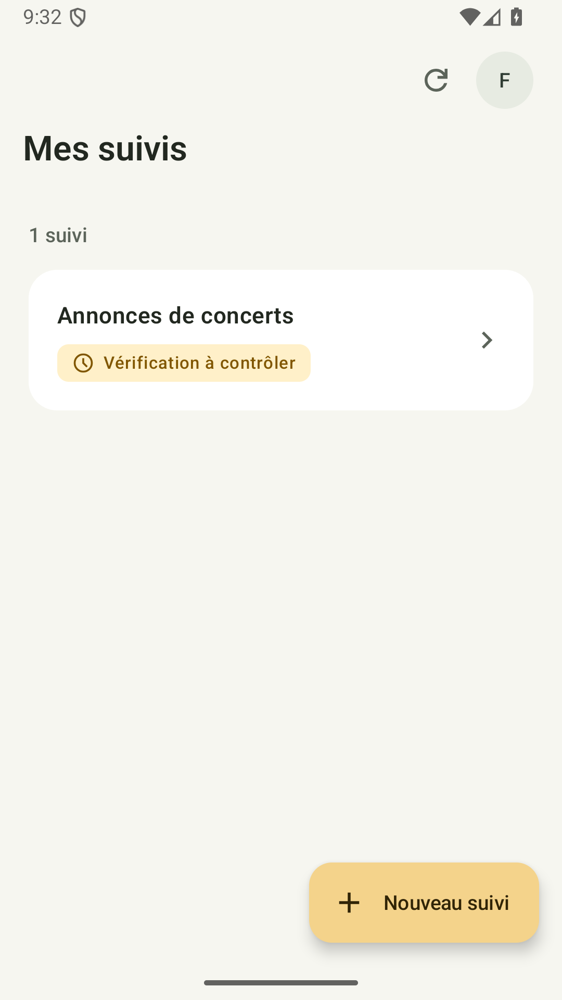
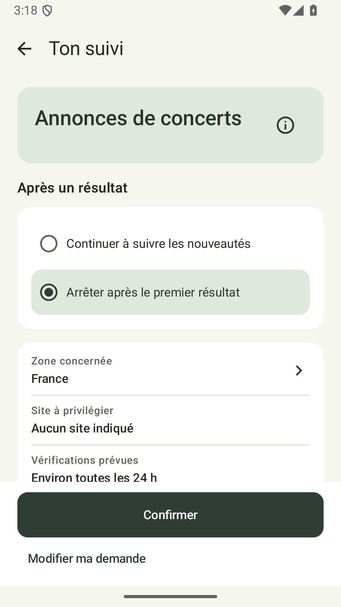
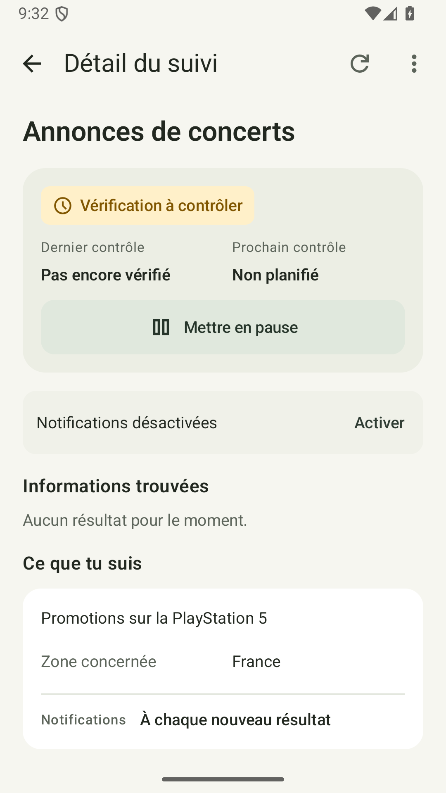

# Préviens-moi

[](https://github.com/vbooo/previens_moi/actions/workflows/android.yml)

Application Android native pour suivre une information publique et recevoir une notification lorsqu’un résultat correspond à sa demande : offre d’emploi, promotion ou annonce.

**Kotlin · Jetpack Compose · Material 3 · Coroutines/StateFlow · Hilt · Supabase · Firebase Cloud Messaging**

Projet personnel conçu pour approfondir le développement Android : gestion d’état, reprises après interruption, opérations asynchrones et tests. La version **0.1.10** fonctionne avec un service réel d’essai ; la publication Play Store et l’exploitation à plus grande échelle restent à préparer.

## Aperçu

<table>
<tr>
<td></td>
<td></td>
<td></td>
</tr>
</table>

Captures natives de parcours contrôlés. Les bilans datés conservent également les anciennes interfaces pour documenter leur évolution.

## Parcours

1. Décrire ce que l’on souhaite suivre, avec un site préféré et une zone géographique si nécessaire.
2. Vérifier les critères compris ou répondre à une question de clarification.
3. Confirmer : la recherche de sources et la préparation se poursuivent côté serveur, application fermée comprise.
4. Consulter les résultats sourcés et recevoir une notification qui ouvre le résultat concerné.
5. Mettre en pause, reprendre, modifier ou supprimer un suivi ; demander la suppression de son compte.

Le statut se synchronise aussi au premier plan : sa mise à jour ne dépend pas uniquement de la réception d’un push. Une réponse réseau incertaine conserve l’identifiant de la commande pour éviter un second effet lors d’une reprise.

## Lancer sans compte ni clé API

Ouvrir **`android/`** dans Android Studio et choisir **`demoDebug`** dans *Build Variants*. Cette variante utilise des repositories en mémoire et des scénarios déterministes ; elle fonctionne sans réseau et sans frais fournisseur.

```sh
cd android
./gradlew assembleDemoDebug
```

La CI fournit aussi l’APK **`previens-moi-offline-demo-debug`** dans les artefacts de son job Android. C’est la variante locale de démonstration, pas un accès au service d’essai connecté.

Pour les recherches réelles, choisir **`remoteDebug`** et renseigner les paramètres publics du client selon [le guide Android](android/README.md). Le fichier `android/client.properties` est ignoré par Git ; son modèle est fourni. Les mots de passe et clés serveur restent côté serveur.

Environnement de compilation : JDK 17, SDK Android 37 et Build Tools 36.0.0 ; wrapper Gradle et dépendances versionnés. Minimum Android : API 23. Android Studio peut utiliser son JDK embarqué compatible.

## Architecture et choix

| Couche | Responsabilité |
| --- | --- |
| `feature/*/presentation` | Compose, navigation, ViewModels et états d’écran via StateFlow. |
| `domain` | Modèles et ports des repositories, indépendants d’Android et des SDK réseau. |
| `data` | Implémentations HTTP, session et persistance locale ; injection par Hilt. |
| `service/supabase` | Auth, PostgreSQL, commandes versionnées, préparation, planification, quotas et historique. |
| OpenAI / Firecrawl | Compréhension et qualification avec preuves / recherche et lecture de pages publiques. |
| Firebase Cloud Messaging | Transport des notifications ; le résultat est relu auprès du service authentifié. |

Un seul module Gradle est conservé : les frontières des couches sont contrôlées sans multiplier les modules pour cette taille de projet. Les variantes séparent les implémentations en mémoire du client connecté.

Quelques points de lecture :

- [WatchesViewModel](android/app/src/main/kotlin/fr/previensmoi/feature/watches/presentation/WatchesViewModel.kt) : état du suivi, commandes et synchronisation.
- [CreateViewModel](android/app/src/main/kotlin/fr/previensmoi/feature/create/presentation/CreateViewModel.kt) : création, clarification, confirmation et restauration.
- [Modèles et ports du domaine](android/app/src/main/kotlin/fr/previensmoi/domain) et [repositories HTTP](android/app/src/main/kotlin/fr/previensmoi/data/remote/RemoteRepositories.kt).
- [Tests de parcours avec la vraie activité](android/app/src/androidTestRemote/kotlin/fr/previensmoi/app/RootJourneyTest.kt) et réponses HTTP contrôlées.
- [Moteur serveur](service/supabase/functions/_shared/general-worker.ts), [preuves](service/supabase/functions/_shared/semantic.ts) et [décision de nouveauté](service/supabase/functions/_shared/novelty.ts).
- [Décisions et architecture détaillée](docs/08-architecture-et-donnees.md).

## Tests et CI

La [CI GitHub Actions](.github/workflows/android.yml) s’exécute sur les push et pull requests, sans configuration du service réel :

- Android : compilation des deux variantes debug, tests unitaires, Lint et frontières d’architecture ; construction release optimisée et contrôle du binaire avec paramètres publics synthétiques.
- Serveur : types et tests Deno avec réponses contrôlées, puis validation du contrat OpenAPI et de ses exemples.
- Secrets : analyse de l’historique Git par Gitleaks ; l’exception documentée ne concerne que les empreintes SHA-256 des faits dans les rapports de qualification.

```sh
# Android, depuis android/
./gradlew assembleDemoDebug assembleRemoteDebug \
  testDemoDebugUnitTest testRemoteDebugUnitTest \
  lintDemoDebug lintRemoteDebug -PlocalService=true

# Serveur, depuis service/ ; Deno 2.5.4
deno task check
deno task test

# Contrat, depuis la racine
python -m pip install -r contracts/requirements.txt
python scripts/check-service-contract.py
```

Les tests natifs sur émulateur, l’intégration PostgreSQL et les qualifications de fournisseurs sont documentés séparément et lancés explicitement. La CI ne les présente pas comme exécutés. Elle ne déploie ni le serveur ni l’application sur Google Play.

## Limites actuelles

Le service connecté est un essai à quota fini, sans promesse de couverture exhaustive du Web. Pour les nouveaux suivis généraux, jusqu’à trois pages publiques sont relues environ toutes les heures ; la découverte de sources est renouvelée tous les 24 passages. Les anciens plans conservent leurs paramètres confirmés.

Une information doit être sourcée et correspondre aux critères ; trouver une page ou constater sa modification ne suffit pas à prouver une nouvelle opportunité. Les pages protégées, les sources non découvertes et l’incertitude du jugement peuvent empêcher un résultat. Une nouvelle annonce d’emploi est distinguée d’une liste d’offres simplement mise à jour.

Restent notamment l’observation prolongée, les règles d’usage publiques, les contrôles de diffusion/confidentialité et la signature release. Le benchmark général de compréhension et une éventuelle modularisation sont différés. La variante connectée release optimisée est construite et contrôlée, mais reste non signée pour la diffusion. Voir la [préparation release et observation](docs/13-release-et-observation.md).

## Documentation

- [Guide Android](android/README.md), [service](service/README.md) et [contrat API](contracts/application-v1.openapi.json).
- [Plan et état courant](docs/10-plan-de-validation-technique.md), [décisions](docs/decisions/README.md), [diagnostics](docs/diagnostics.md).
- [Dernière qualification Android](validation/form-polish/bilan.md), [correctif des alertes d’emploi](validation/job-opportunities/bilan.md), [bilans de validation](validation).

Les documents de conception et bilans historiques expliquent les choix et leurs limites ; leur date fait foi. Ils ne constituent pas des résultats de tests de la CI actuelle.
