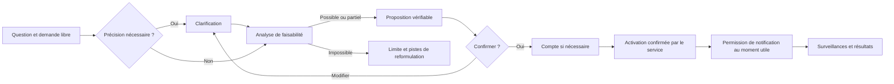

# Parcours et écrans

Validé par Fabien le 2 octobre 2026. Ce document traduit le [périmètre du MVP validé](03-perimetre-mvp.md) en comportements visibles. Les choix sur l’accueil, la consultation des résultats et l’adresse de page publique en secours sont consignés dans la [décision 0004](decisions/0004-parcours-et-ecrans.md). Les règles de détection, les sources, les quotas, le mode d’identification et les durées de conservation relèvent respectivement des documents 05 à 08. Ce document décrit des besoins d’interface, sans figer la navigation technique ni la direction graphique.

## Principes de conception validés

| Référence | Principe | Statut |
| --- | --- | --- |
| UX-D01 | Partir de « De quoi veux-tu être prévenu ? », sans questionnaire obligatoire de profil ni catalogue imposé. | Hérité des documents 01 et 03 validés. |
| UX-D02 | Permettre la formulation et la prévisualisation sans compte ; demander un compte à la première activation durable. | Hérité du document 03 validé. |
| UX-D03 | Ne présenter une surveillance comme active qu’après confirmation des critères et réponse positive du service. | Hérité des documents 01 et 03 validés. |
| UX-D04 | Viser le français et l’anglais au lancement, sous réserve de vérifier tous les parcours et textes produits ; sinon publier d’abord en français. | Hérité du document 03 validé. |
| UX-D05 | Conserver la saisie pendant un retour arrière, une interruption courante ou un échec ; ne pas confondre une saisie conservée avec une surveillance active. | Validé lors de la revue du document 04. |
| UX-D06 | Ne pas annoncer une action de pause, modification ou suppression comme effective avant la confirmation du service. | Conséquence du scénario MVP-A12 validé. |
| UX-D07 | Montrer le minimum utile en première lecture et rendre les sources, limites et détails accessibles sans les masquer. | Validé lors de la revue du document 04. |
| UX-D08 | Après la première surveillance, conserver la question principale visible avec la liste en dessous ou immédiatement accessible, sans nouvel onboarding. | Validé par Fabien. |
| UX-D09 | Ne pas ajouter de boîte globale des alertes dans la V1 : consulter les résultats dans chaque surveillance et depuis les notifications. | Validé par Fabien. |
| UX-D10 | Proposer l’adresse d’une page Web publique connue de la personne uniquement comme secours lorsque la recherche automatique ne trouve pas de source exploitable. | Validé par Fabien ; la page doit être qualifiée avant toute activation. |

L’application ne demande pas à la personne d’apprendre les termes « agent », « prompt », « RSS » ou « modèle ». Les écrans doivent parler de la demande, de la vérification, de la source et de l’alerte. Les exemples de demandes sont facultatifs et ne constituent pas une promesse de prise en charge de toute demande ressemblante.

## Vue d’ensemble du parcours

Cette vue montre des étapes logiques : certaines peuvent partager un écran. L’ordre impose toutefois que la personne voie la portée et les limites avant l’activation, et que l’inscription n’empêche pas la prévisualisation. Une analyse de faisabilité peut prendre du temps ; l’interface doit distinguer attente, résultat exploitable et échec technique.

## Inventaire fonctionnel des surfaces

| Référence | Surface | Objectif principal | Entrée possible |
| --- | --- | --- | --- |
| UX-S01 | Accueil et saisie | Décrire ce qu’il faut surveiller et retrouver ses surveillances si la personne est connectée. | Ouverture normale, retour depuis une autre surface. |
| UX-S02 | Clarification | Obtenir seulement les précisions nécessaires et corriger la demande. | Analyse initiale ou modification de proposition. |
| UX-S03 | Analyse en cours | Indiquer qu’une méthode et un état initial sont recherchés. | Envoi d’une demande suffisamment définie. |
| UX-S04 | Proposition de surveillance | Faire confirmer la condition, la portée, la méthode observée et les limites. | Analyse réussie ou partiellement réussie. |
| UX-S05 | Demande non prise en charge | Expliquer la raison et permettre de reprendre une formulation utile. | Analyse sans méthode exploitable. |
| UX-S06 | Identification | Créer ou retrouver le compte au moment de la première activation durable. | Confirmation d’une proposition sans session valide. |
| UX-S07 | Autorisation des notifications | Expliquer le bénéfice, demander la permission système, accepter le refus. | Après activation confirmée, ou depuis les réglages. |
| UX-S08 | Liste des surveillances | Voir les surveillances et leur état, accéder au détail, créer une nouvelle demande. | Accueil connecté, retour de création ou d’une notification. |
| UX-S09 | Détail d’une surveillance | Comprendre les critères et l’état, consulter les résultats, modifier, suspendre ou supprimer. | Liste ou résultat. |
| UX-S10 | Résultat d’alerte | Expliquer une nouveauté et ouvrir les preuves. | Notification ou détail. |
| UX-S11 | Réglages utiles | Voir la langue, l’état des notifications, le compte et les options de données prévues. | Navigation depuis l’accueil ou la liste. |

Une surface « analyse en cours » ou « permission » peut être une étape dans un écran existant. Aucun menu de catégories, fil d’actualité général, carte ou assistant conversationnel permanent n’est requis. Un écran global supplémentaire regroupant toutes les alertes est exclu de la V1 validée : chaque résultat reste accessible dans sa surveillance et par sa notification.

## Création : saisie et clarification

### UX-S01 — accueil et saisie

La question principale est visible immédiatement. Le champ accepte une phrase libre et peut être complété par deux ou trois exemples illustrant des formes de besoin différentes, sans annoncer une couverture garantie. Une personne connectée peut accéder à ses surveillances sans avoir à créer une nouvelle demande. Aucun choix préalable de métier, centre d’intérêt, catégorie ou fréquence n’est obligatoire.

L’action principale envoie la demande à l’analyse si elle n’est pas vide. Une demande vide reçoit une indication près du champ, sans perdre le focus. Une demande trop vague n’est pas rejetée par un simple compteur de mots : l’application demande ensuite la précision manquante. Les limites techniques de longueur, si nécessaires, doivent être explicites et justifiées ; elles ne sont pas définies ici.

Avant tout appel réseau utilisant le texte de la personne, une information accessible explique que la demande est traitée par le service et peut impliquer des fournisseurs selon l’architecture retenue. Le texte final et les choix de confidentialité seront fixés dans le document 08. Le brouillon reste disponible si l’application passe en arrière-plan, si l’utilisateur revient en arrière ou si l’envoi échoue. Sa durée de conservation reste à définir, sans en faire une surveillance active.

### UX-S02 — clarification

L’interface restitue ce qu’elle a compris et ne demande que les champs nécessaires ou contradictoires. Elle réutilise le lieu, la période, le sujet, le seuil et les exclusions déjà exprimés. Une question peut proposer des réponses rapides, mais laisse une réponse libre lorsque la précision attendue ne tient pas dans les choix. La personne peut corriger sa demande d’origine et revenir à l’étape précédente sans perdre ses réponses.

Une cible de zéro à trois questions pour les cas courants oriente la conception ; ce n’est ni un plafond rigide ni une raison d’accepter une demande ambiguë. Si l’application ne peut pas obtenir une condition exploitable après des demandes compréhensibles, elle explique le blocage au lieu de tourner en boucle. Les détails de l’interprétation et la politique d’échec du moteur relèvent du document 06.

Pour un suivi général (« les nouvelles importantes sur… »), l’interface fait confirmer des types de nouveautés observables et, si nécessaire, des exclusions. Le mot « important » ne doit pas devenir un critère invisible. Pour une demande locale sans lieu fourni, elle demande une ville ou une zone ; la localisation de l’appareil reste facultative et ne remplace pas automatiquement une zone explicitement donnée.

## Création : analyse, résultat et activation

### UX-S03 — analyse en cours

L’interface indique que la faisabilité et l’état initial sont recherchés, sans donner l’impression qu’une surveillance tourne déjà. Elle conserve la demande et les précisions. Si l’analyse échoue temporairement, la personne peut réessayer ; si elle abandonne, aucune surveillance n’est activée. Un délai, une annulation ou une reprise technique doivent produire un état compréhensible. Aucune estimation de durée ou promesse de vérification immédiate n’est affichée sans mesure réelle.

Le résultat de l’analyse distingue quatre issues visibles : proposition complète, proposition partielle, besoin de précision supplémentaire et demande non prise en charge. Une erreur du service ou du réseau ne signifie pas que la demande est impossible. Une information déjà connue doit apparaître comme état initial, pas comme première nouveauté à notifier.

### UX-S04 — proposition de surveillance

La proposition doit répondre, en langage courant, à ces questions :

| Question | Information à montrer avant activation |
| --- | --- |
| Que surveillera-t-on ? | Sujet précis, lieu ou périmètre, période et condition de déclenchement. |
| Qu’est-ce qui déclenchera une notification ? | Types de nouveautés retenus, seuil éventuel, exclusions et exemples courts si utiles. |
| Que ne surveillera-t-on pas ? | Limites connues, partie de la demande refusée ou couverture incertaine. |
| Sur quoi repose la proposition ? | Méthode présentée sans jargon, sources publiques initialement trouvées et liens consultables ; cette liste n’est pas annoncée comme exhaustive. |
| Que sait-on déjà ? | État initial et date de constat, avec distinction entre date de la source et date de vérification. |
| À quel rythme ? | Cadence réellement promise, prochaine vérification si connue et absence de garantie de temps réel. |
| Quel effet sur l’offre ? | Limite ou coût applicable avant activation, selon les décisions du document 07. |

La personne peut corriger les critères et relancer l’évaluation, confirmer ou abandonner. Si seule une portée réduite est faisable, la différence avec la demande d’origine apparaît visiblement et nécessite une confirmation explicite ; un bouton « Activer » ne vaut pas acceptation d’une réduction cachée. Si l’événement demandé est déjà survenu et qu’aucune condition future ne reste vérifiable, l’application ne propose pas d’alerte active pour ce même événement. Elle peut aider à reformuler un suivi futur.

### UX-S05 — demande non prise en charge

Le message distingue autant que possible : condition manquante, source introuvable, accès privé ou non autorisé, méthode momentanément indisponible et type de demande hors périmètre. Il dit ce qui a été tenté et ce qui reste incertain, sans affirmer que l’information n’existe nulle part. Les actions utiles sont « Préciser ma demande », « Réessayer » pour un échec temporaire et « Revenir à l’accueil ». Si la recherche automatique ne trouve pas de source exploitable, « Indiquer une page Web » est proposé en secours. Aucun bouton d’activation ne doit contourner le refus.

Concrètement, la personne peut coller l’adresse Web publique d’une billetterie ou d’une page d’annonces qu’elle connaît déjà. Cette adresse est une piste à analyser, pas une preuve de faisabilité ni une source fiable par défaut : le service doit vérifier que la page est accessible, pertinente, utilisable et surveillable dans la durée. Une page privée ou derrière une connexion ne devient pas prise en charge grâce à cette saisie. L’option n’apparaît pas sur l’accueil principal et ne remplace jamais la recherche automatique.

### UX-S06 — identification et confirmation d’activation

L’identification n’apparaît qu’après la prévisualisation, quand la personne choisit d’activer sa première surveillance durable. Si elle possède déjà une session valide, cette étape est sautée. La méthode de connexion, de récupération et de suppression de compte reste à choisir dans le document 08 ; aucun fournisseur n’est présupposé ici.

La proposition est conservée pendant l’identification. Un abandon ou un échec de connexion ne crée pas de surveillance active. Après connexion, l’application réaffiche la proposition si ses critères, limites ou conditions ont changé ; elle ne transforme pas silencieusement un ancien accord en activation d’une nouvelle portée. L’action d’activation indique une attente puis une réussite seulement après accusé du service. En cas de réponse incertaine, elle vérifie l’état réel avant d’autoriser une nouvelle tentative, pour éviter deux surveillances identiques créées par répétition du bouton.

### UX-S07 — permission de notification

Une courte explication relie la permission à la surveillance que la personne vient d’activer. L’application demande la permission système au moment utile, après confirmation de l’activation et sans bloquer celle-ci si la permission est refusée. En cas de refus, les résultats restent accessibles dans l’application et l’état « notifications désactivées » est visible dans la liste ou le détail et dans les réglages. L’application n’insiste pas à chaque ouverture ; elle indique comment rétablir l’autorisation. L’interface évite de promettre une notification si le système ne l’autorise pas.

## Consultation et contrôle

### UX-S08 — liste des surveillances

Chaque entrée comporte un titre reconnaissable, un état, la dernière vérification réussie ou « aucune vérification réussie » et la prochaine vérification prévue lorsqu’elle est connue. Un échec récent ne remplace pas la date de dernière réussite. Une absence de nouveauté lors d’une vérification réussie est distincte d’une panne. Un indicateur signale les résultats non encore consultés, sans transformer l’écran en fil général.

États à distinguer : active et en attente de première vérification ; active sans nouveauté récente ; en pause ; attention requise après panne ou perte de couverture ; suspendue par une limite d’usage ; terminée si les règles du document 05 retiennent cette fin. Le vocabulaire exact sera testé auprès d’utilisateurs. Une liste vide explique la proposition du produit et renvoie à la question principale. Un chargement, une erreur de récupération et l’absence de réseau ont des messages distincts ; un contenu précédemment affiché ne doit pas être présenté comme fraîchement synchronisé.

### UX-S09 — détail d’une surveillance

Le détail présente les critères confirmés, les limites connues, la cadence annoncée, la dernière réussite, le dernier échec s’il existe, la prochaine vérification lorsqu’elle est connue et les résultats sourcés conservés. Il ne promet pas un journal exhaustif de chaque exécution. Les actions sont modifier, suspendre ou reprendre, puis supprimer. Une action destructrice exige une confirmation lisible et explique son effet sur les futures vérifications ; la suppression des données de compte reste un parcours distinct.

Une modification ouvre une nouvelle proposition à confirmer. Jusqu’à l’acceptation effective du changement par le service, l’ancienne surveillance reste dans son état réel ; l’interface ne mélange pas anciens et nouveaux critères. Si le téléphone perd le réseau, le bouton ne présente pas la pause ou la suppression comme réalisée. Après confirmation effective d’une pause ou suppression, aucune nouvelle notification liée à cette surveillance ne doit être émise ; les règles concernant une vérification déjà en cours sont précisées au document 05.

### UX-S10 — résultat d’alerte

Le résultat répond à quatre questions : quelle nouveauté, pourquoi elle correspond à la demande, quand elle a été constatée et quelles sources la soutiennent. Il distingue date de l’événement, date de publication et date de vérification lorsque ces dates sont disponibles. Si une date manque, elle est marquée inconnue plutôt qu’inventée. Les liens s’ouvrent avec un intitulé identifiable. Les éléments incertains ou contradictoires sont signalés ; une correction importante est présentée comme correction, non comme nouvel événement indépendant.

Une notification mène directement au résultat concerné. Si l’application demande une nouvelle connexion, elle reprend ensuite ce chemin. Si le résultat a été supprimé, n’est plus accessible ou appartient à un autre compte, un message compréhensible renvoie vers la liste sans exposer d’informations d’un autre compte. L’ouverture de la notification ne change pas les critères ni l’état de la surveillance.

### UX-S11 — réglages utiles

Les réglages donnent accès à la langue de l’interface, à l’état des notifications et au chemin approprié pour les réactiver, aux informations du compte, ainsi qu’aux parcours de suppression des données prévus au document 08. Ils affichent les limites de l’offre retenue lorsque cela aide à comprendre une suspension. Les choix de cadence ou d’heures calmes n’apparaîtront que si leurs règles sont validées dans les documents 05 et 07.

## États transversaux et retour arrière

| Situation | Comportement visible requis |
| --- | --- |
| Envoi de demande interrompu | Garder le texte et les précisions ; proposer un nouvel essai sans annoncer d’analyse achevée. |
| Analyse lente | Montrer qu’elle est en cours et permettre une sortie sans activer d’alerte. |
| Analyse techniquement échouée | Proposer un nouvel essai ; ne pas afficher « impossible à surveiller » comme conclusion. |
| Aucune méthode exploitable | Expliquer la limite et proposer une reformulation ou l’adresse d’une page publique à qualifier ; ne pas activer avant qu’une méthode soit vérifiée. |
| Retour depuis la proposition | Conserver le brouillon et les réponses ; une correction relance la faisabilité si nécessaire. |
| Connexion abandonnée ou échouée | Conserver la proposition pour reprise ; ne pas créer une surveillance active. |
| Activation incertaine | Vérifier l’état du service avant de permettre une nouvelle activation. |
| Permission refusée | Garder l’alerte active côté service et les résultats consultables ; afficher l’absence de notifications. |
| Modification non transmise | Conserver l’état confirmé précédent, signaler que la nouvelle demande n’a pas pris effet. |
| Erreur sur une source active | Montrer la dégradation et conserver la date de dernière réussite ; ne pas annoncer « aucune nouveauté ». |
| Quota atteint | Montrer la suspension effective, sa cause et la reprise possible selon le document 07. |
| Lien de notification périmé | Expliquer l’indisponibilité et proposer la liste des surveillances. |

La consultation hors ligne complète est reportée. Le brouillon de saisie et les informations déjà présentes peuvent rester visibles selon l’implémentation, mais l’interface indique leur ancienneté ou l’impossibilité de confirmer une action. Le comportement précis de la mise en cache et la durée de conservation appartiennent au document 08.

## Langues, lisibilité et accessibilité

La langue initiale suit celle de l’appareil lorsqu’elle est prise en charge ; sinon le français est proposé comme repli pour le lancement prioritaire en France. La personne peut la changer sans altérer le lieu, le seuil ou les critères d’une surveillance. Les textes d’interface, erreurs, permissions expliquées, notifications, critères reformulés et résultats générés doivent être vérifiés dans chaque langue effectivement annoncée. Un titre ou une citation de source peut rester dans sa langue d’origine, clairement attribuée.

Dates, heures, nombres, unités, devises et fuseaux horaires sont affichés dans un format compréhensible pour la langue choisie. L’interface distingue par exemple « publié le », « vérifié le » et « prochaine vérification ». Elle ne réduit pas un état à sa couleur : libellé et, si utile, icône le complètent. Les textes agrandis, le lecteur d’écran, l’ordre de lecture, les cibles tactiles et les contrastes sont vérifiés sur les parcours clés. Les messages d’erreur désignent l’action possible au lieu d’afficher seulement un code technique.

La direction visuelle, les maquettes et les composants Android seront conçus après validation de ces comportements. Ils devront être évalués sur des téléphones de tailles variées ; une mise en page plus large n’est pas nécessaire pour décider de la logique de ces parcours.

## Exigences traçables

| Référence | Exigence d’interface |
| --- | --- |
| UX-R01 | Démarrer une demande libre sans profil, catégorie imposée ni compte. |
| UX-R02 | Conserver le brouillon et les précisions lors des retours et échecs courants. |
| UX-R03 | Clarifier les critères indispensables en conservant ce qui est déjà connu. |
| UX-R04 | Distinguer analyse en cours, proposition complète, proposition partielle, précision nécessaire, impossibilité et panne technique. |
| UX-R05 | Présenter critères, exclusions, sources, état initial, cadence, limites et effet sur l’offre avant activation. |
| UX-R06 | Obtenir une confirmation explicite d’une portée réduite et refuser toute activation sans méthode exploitable. |
| UX-R07 | Demander le compte après la prévisualisation et préserver la proposition pendant l’identification. |
| UX-R08 | Confirmer l’activation seulement après réponse du service et éviter les créations doubles lors d’une réponse incertaine. |
| UX-R09 | Demander la permission de notification au moment utile et permettre la consultation malgré un refus. |
| UX-R10 | Montrer les états, la dernière réussite, le dernier échec et la prochaine vérification si connue. |
| UX-R11 | Donner accès aux résultats sourcés et expliquer chaque notification. |
| UX-R12 | Permettre modification, pause, reprise et suppression, avec état réel visible jusqu’à confirmation du service. |
| UX-R13 | Reprendre le bon résultat depuis une notification, même après une étape de connexion ; gérer un lien périmé ou non autorisé. |
| UX-R14 | Localiser les parcours livrés et vérifier leur accessibilité. |
| UX-R15 | Après une recherche automatique de source infructueuse, permettre d’indiquer une adresse de page publique et en vérifier la faisabilité avant une nouvelle proposition. |

## Scénarios d’acceptation validés à ce stade

Les valeurs de données et les services simulés seront précisés dans les tests du document 09. Ces scénarios servent à vérifier le comportement, sans imposer une technologie d’écran ou de navigation.

| Référence | Étant donné | Quand | Alors | Exigences |
| --- | --- | --- | --- | --- |
| UX-A01 | L’application vient d’être installée. | La personne l’ouvre. | Elle voit la question principale et peut saisir une demande sans créer de compte ni sélectionner une catégorie. | UX-R01 |
| UX-A02 | Une demande contient déjà une ville et une période. | Une clarification est nécessaire pour le type d’événement. | La ville et la période restent reprises ; elles ne sont pas redemandées. | UX-R03 |
| UX-A03 | Une demande générale emploie « important ». | La personne poursuit. | Les types de nouveautés retenus sont explicités et modifiables avant activation. | UX-R03, UX-R05 |
| UX-A04 | Une analyse échoue à cause du réseau. | La personne revient à la saisie. | Son texte reste présent ; l’interface propose de réessayer sans conclure que la demande est impossible. | UX-R02, UX-R04 |
| UX-A05 | Une méthode ne couvre qu’une partie de la demande. | La proposition est affichée. | La partie non couverte est visible et l’activation exige une acceptation explicite de la portée réduite. | UX-R05, UX-R06 |
| UX-A06 | Aucune méthode exploitable n’existe pour une demande. | L’analyse se termine. | Aucune activation n’est offerte ; la personne reçoit une explication et une piste utile si elle existe. | UX-R04, UX-R06 |
| UX-A07 | L’événement demandé est déjà passé sans condition future. | L’état initial est présenté. | Une alerte active pour ce même événement n’est pas proposée comme si une nouveauté future était attendue. | UX-R05, UX-R06 |
| UX-A08 | Une proposition a été prévisualisée sans compte. | La personne choisit de l’activer puis se connecte. | Elle retrouve la même proposition et l’activation n’est confirmée qu’après réponse du service. | UX-R07, UX-R08 |
| UX-A09 | La réponse à l’activation est incertaine. | La personne revient ou touche de nouveau l’action. | L’application établit l’état réel avant d’autoriser une autre création ; aucun succès fictif n’est montré. | UX-R08 |
| UX-A10 | La première surveillance est active. | La personne refuse la permission de notification. | La surveillance reste consultable, l’absence de notifications est visible et un chemin de réactivation est indiqué. | UX-R09 |
| UX-A11 | Une source échoue après une vérification réussie. | La liste et le détail sont ouverts. | Le dernier échec apparaît sans remplacer la date de dernière réussite ni indiquer « aucune nouveauté ». | UX-R10 |
| UX-A12 | Une modification est saisie pendant une coupure réseau. | La personne tente de la confirmer. | Les critères précédemment confirmés restent affichés comme effectifs ; la modification n’est pas annoncée comme appliquée. | UX-R02, UX-R12 |
| UX-A13 | Une notification concerne un résultat existant. | La personne l’ouvre après expiration de sa session. | Après connexion, le résultat correct s’ouvre sans exposer les données d’un autre compte. | UX-R11, UX-R13 |
| UX-A14 | Un résultat pointé par une notification a disparu. | La personne ouvre la notification. | Elle voit un état indisponible compréhensible avec retour vers ses surveillances. | UX-R13 |
| UX-A15 | La personne change la langue de l’interface. | Elle rouvre une surveillance locale. | Les critères, la zone et le seuil sont inchangés ; les textes livrés et les formats s’adaptent. | UX-R14 |
| UX-A16 | Le texte est agrandi et un lecteur d’écran est actif. | La personne parcourt création, proposition et détail. | Les informations nécessaires et les actions restent accessibles sans dépendre d’une couleur seule. | UX-R14 |
| UX-A17 | La recherche automatique ne trouve aucune source exploitable. | La personne indique l’adresse d’une page publique qu’elle connaît. | L’application évalue cette page et n’active la surveillance que si une méthode exploitable est confirmée ; une page privée ou inutilisable produit une limite expliquée. | UX-R06, UX-R15 |

## Arbitrages validés lors de la revue

Fabien a validé l’accueil centré sur la question principale, avec accès immédiat aux surveillances, et l’absence de boîte globale des alertes dans la V1. Il a également validé l’adresse d’une page publique comme voie de secours, seulement après un échec de recherche automatique et sous réserve de qualification. Ces choix sont enregistrés sous UX-D08 à UX-D10. Le choix du fournisseur de compte, la cadence, les heures calmes, le rattrapage après pause, les durées de stockage et les prix restent dans leurs documents respectifs.

## Retours UI à traiter après les tests d’achat — 19 novembre 2026

Retours de Fabien sur la version de test Play, à intégrer à la prochaine passe UI ; ces changements ne sont pas encore implémentés.

- Ajouter un accès clair à l’aide, au contact et à l’envoi de retours ou de signalements de bugs. Définir le canal de réception avant le raccordement.
- Sur l’accueil connecté sans suivi, proposer un vrai bouton principal « Nouveau suivi » au centre de l’état vide ; rendre les actions de connexion plus visibles.
- Recomposer l’écran d’abonnement avec une offre lisible, un prix visible, de vrais boutons et une liste précise des limites : deux suivis actifs, trois sources par suivi, vérification quotidienne et cinq créations/changements de sujet par période payée. Retirer la phrase vague « Plus de suivis, au-delà de l’essai gratuit ».
