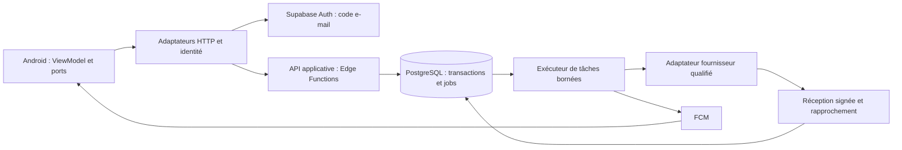

# Service réel — spécification S3-01

20 octobre 2026. **Service local isolé implémenté ; aucun service cloud déployé.** Choix techniques dans l'[ADR 0011](decisions/0011-service-reel-s3.md), contrat machine dans [OpenAPI v1](../contracts/application-v1.openapi.json). Références produit : documents 03/04/05/07/08/09. Le backlog actif reste le document 10.

## Objectif et frontières

Remplacer le service demo S2 sans prétendre que ses scénarios sont une intelligence opérationnelle. Android soumet des commandes et affiche les états confirmés ; le service possède les comptes, plans, contrôles, résultats et limites. La saisie libre, les suivis généraux et la possibilité de rechercher de nouvelles sources restent inchangés.

Pas de lecture directe des tables depuis Android ; pas de clé privilégiée dans l'APK. L'API d'identité gérée reste distincte de notre API métier. Les routes de webhook et de worker sont séparées des routes utilisateur ; pas de vérification JWT désactivée globalement pour faciliter un webhook.

## Identité et prévisualisation

- Une session de prévisualisation est créée sans compte : secret aléatoire de 256 bits, durée maximale 24 h, empreinte seulement en base. Ce secret protège les propositions de la session ; un identifiant UUID seul ne donne aucun accès. Limites de fréquence, de stockage et de coût globales appliquées **avant** création et analyse. IP issue du proxy de confiance, empreinte salée à rotation courte ; un UUID choisi par le client ne contourne pas le quota.
- Supabase Auth génère et vérifie le code e-mail. Ni l’application ni notre base métier ne conservent le code. Configuration cible à vérifier dans Auth : expiration du code après 10 minutes, renvoi au plus une fois par minute, tentatives de vérification bornées par les limites du fournisseur ; ne pas inventer une protection locale qui serait contournable. À la première activation, Android demande l'adresse puis le code, reprend la proposition, montre une nouvelle confirmation si sa version ou portée a changé. La possession du secret de prévisualisation et une session utilisateur valide sont nécessaires pour attribuer une proposition non encore revendiquée.
- Client d'identité isolé dans `data/auth` ; API officielle d'Auth, sans SDK dans le domaine. Vérifier les formats et les options Auth dans ses tests d'intégration. Session protégée au repos par une clé Android Keystore, exclue des sauvegardes ; jamais dans les journaux ou SavedStateHandle. Rafraîchissement unique et coordonné, puis nouvel essai d'une lecture/commande avec le même identifiant. Une panne de rafraîchissement ne crée pas un nouveau compte.
- Serveur : validation de signature, émetteur, audience, expiration ; identité issue du jeton validé. Vérification du compte non supprimé à chaque accès, même si un ancien JWT est encore valide. RLS sur les données accessibles, schéma privé pour jobs, coûts et reçus internes. Les fonctions privilégiées contrôlent explicitement le propriétaire ; `service_role` ne bénéficie pas automatiquement de RLS.
- Déconnexion : retirer l'appareil du compte quand le réseau est disponible, effacer les secrets et données de session locales même si la requête échoue. Un push déjà en vol ne doit pas réafficher des informations du compte précédent.
- Envoi e-mail : transport Resend envisagé avec domaine vérifié ; quota global de messages et protection contre les abus sur le chemin Auth lui-même, pas seulement dans Android. Le hook d’envoi doit vérifier la signature d’Auth sur le corps brut avant toute action, réserver avant envoi et échouer explicitement si indisponible. Pas de contournement par les endpoints publics Auth. SMTP de démonstration Supabase limité à l'équipe : ne pas inviter des testeurs comme administrateurs pour contourner cette restriction.

## Contrat HTTP et adaptation de S2

L'OpenAPI 3.1 décrit les requêtes/réponses métier ; domaine de serveur réservé `.invalid` tant qu'aucun environnement n'est déployé. JSON UTF-8, identifiants opaques, instants UTC RFC3339, pagination par curseur opaque et ordre stable `(created_at,id)`. Réponses privées `Cache-Control: no-store`. Aucune chaîne fournisseur utilisée comme code d'erreur.

| Parcours | Échange | Comportement |
| --- | --- | --- |
| Prévisualiser | POST session, POST evaluation, GET evaluation | 202 = travail reçu ; statut pending puis ready/clarification/unsupported/failed. Brouillon et sa révision sont associés au travail. |
| Lire proposition | GET proposal avec secret de prévisualisation | Le plan confirme critères, exclusions, portée, méthode, cadence, limites et expiration. Sources initiales éventuellement vides si la recherche récurrente est qualifiée. |
| Activer / modifier | POST command avec JWT et preuve de possession de la proposition | Vérifier version, expiration, consentement partiel et capacité. Retour pending tant que l'état initial et la surveillance distante ne sont pas réellement prêts. |
| Pause / reprise / suppression | Même route de commandes, puis GET command | Même identifiant pour réessai après perte réseau. L'état local effectif et l'arrêt distant sont distincts dans le reçu. |
| Listes et résultats | GET watches, watch, findings | Lecture limitée au propriétaire. Ressource d'un autre compte et ressource absente donnent le même 404. |
| Appareil | PUT / DELETE device | Jeton FCM lié à une installation et au compte authentifié ; rotation remplace l'ancien. Pas d'email dans le push. |
| Effacer compte | POST account/deletion | Réauthentification par code datant de moins de cinq minutes, blocage immédiat des accès/envois, purge asynchrone suivie en interne. Pas de faux 200 « tout effacé » avant purge. |

**Écarts explicites avec le double S2 :** enrichir les modèles de clarification (questions identifiées), critères, limites, preuves et dates ; introduire le suivi d'une opération pending ; ajouter une vraie saisie/vérification de code à `SessionRepository`. Les ports S2 actuels simplifiés ne sont pas un contrat réseau exhaustif. Les ViewModels restent sans Retrofit/SDK. Cette évolution fait partie de S3-02 ; les tests S2 resteront des tests de non-régression.

Android persiste les identifiants des opérations en cours, pas une commande complète contenant un secret. Après relance, il relit l'opération. Une attente expirée côté téléphone signifie « résultat encore inconnu » ; elle ne justifie jamais un nouvel identifiant d'activation. Une analyse annulée/tardive ne remplace pas la saisie corrigée.

## Commandes, transactions et état distant

1. Authentifier, vérifier propriétaire et fermeture éventuelle du compte, valider le corps. Ne jamais accepter `ownerId` du client.
2. Transaction SQL : verrou du compte/capacité et ressource ; chercher le reçu par `(owner_id,command_id)`. Empreinte canonique des paramètres hors secret de transport. Un autre contenu avec le même identifiant échoue avec `command_conflict`. Un reçu existant revient **avant** le contrôle d'expiration d'une proposition déjà consommée, après contrôle d'accès.
3. Vérifier version attendue, état, expiration serveur, consentement et budget. Écrire dans la même transaction réservation, opération et job. Aucun appel HTTP fournisseur sous verrou SQL.
4. Worker : prendre un bail, traiter une étape bornée, enregistrer résultat ou prochaine tentative. Une panne après création distante mais avant reçu impose un rapprochement ; pas de deuxième création aveugle. Si le prestataire ne permet pas de résoudre l'ambiguïté, état pending/degraded et arrêt des reprises créatrices, intervention explicite.
5. Activation : publier `active` seulement lorsque méthode qualifiée, état initial et contrôle récurrent sont confirmés. Échec : libérer les réservations non consommées, arrêter tout monitor créé et vérifier son arrêt. Une proposition partielle ne s'active jamais sans consentement à sa version.
6. Pause : bloquer immédiatement nouvelles intentions d'envoi et planifications locales, incrémenter la version ; arrêter le prestataire ensuite. La réponse expose `remoteState=stopping/unknown` jusqu'au rapprochement. Android affiche « suivi suspendu, arrêt du service en cours » si nécessaire. Ne pas confondre absence de notifications et fin de facturation distante.
7. Reprise : réservation puis nouvel état initial sans rattrapage, activation après confirmation. Modification : garder l'ancien plan confirmé jusqu'à l'arrêt de son exécution et la préparation du nouveau ; état de transition visible. Aucune émission issue de l'ancienne génération après remplacement.
8. Suppression : rendre ressource et résultats immédiatement indisponibles, bloquer jobs/envois, conserver seulement le minimum opérationnel pour arrêter le monitor. Effacer ce minimum après arrêt confirmé ; incident à résoudre si arrêt impossible. La limite des 14 jours ne devient pas un droit de conserver indéfiniment des données.

Les reçus complets durent 14 jours, sans texte privé supplémentaire. Après cette fenêtre, les reprises d'une commande ne sont plus admises : le serveur vérifie l'âge de son identifiant UUIDv7, conserve les marqueurs de consommation nécessaires à empêcher une réactivation, et renvoie `command_expired`. UUIDv7 horodaté futur de plus de cinq minutes refusé. Après suppression du compte, aucun reçu ne restitue son contenu. Les propositions sont consommables une seule fois, même avec un nouvel identifiant de commande.

## Base et contraintes retenues

| Ensemble | Contraintes minimales |
| --- | --- |
| accounts / devices | Compte = identité vérifiée ; jeton unique, transfert uniquement après nouvelle authentification ; statut de suppression contrôlé. |
| preview_sessions / evaluations / proposals | Secret haché, révision, expiration ; attribution unique au compte ; état d'analyse durable. |
| watches / plan_versions | Propriétaire, version de ressource monotone, plan immuable, génération du contrôle ; sources limitées à la portée confirmée. |
| commands / jobs | Unique `(owner_id,command_id)` ; empreinte de contenu ; bail expirant, nombre d'essais borné ; récupérable après crash. |
| capacity / reservations / usage | Verrou de capacité partagé, coût réservé avant appel ; valeurs entières en unités fournisseur/microdevise, jamais flottants financiers. |
| checks / findings / evidence | Unique passage fournisseur ; fait métier/version unique ; preuve enregistrée, dates précises ou inconnues, correction liée à son original. |
| delivery_outbox / devices | Unique `(finding_id,device_id)` ; autorisation/version revérifiées avant émission ; pas de contenu privé dans FCM. |
| erasure_ledger | Marqueurs minimaux nécessaires au rejeu d'effacement lors d'une restauration ; accès d'exploitation uniquement. |

Migrations SQL versionnées, contraintes et tests de concurrence sur PostgreSQL réel. Un dictionnaire en mémoire ne prouve pas la transaction ni RLS. Fonctions SQL privilégiées : `search_path` fixé, droits d'exécution retirés aux rôles publics et périmètre testé. Pas de Data API ouverte sur les tables internes.

## Réception, détection et notifications

Le webhook vérifie la signature sur les octets bruts avant stockage/traitement, borne la taille et rejette les formats inconnus. Dédupliquer identifiant fournisseur, suivi, génération et passage ; rapprocher de l'API authentifiée selon la preuve F3. L'inbox durable est acquittée après écriture. Arrivée désordonnée, rejeu et passage inconnu ont chacun un cas de test.

Un `meaningful=true` fournisseur n'est pas à lui seul une preuve. L'adaptateur qualifié doit produire critères couverts, faits, URL et preuve vérifiable, distinction publication/observation et identité de nouveauté. Pas de seconde IA obligatoire : une lacune constatée est traitée explicitement en S3-03. Une date de publication inconnue peut rester inconnue ; elle ne justifie pas une alerte de « nouvelle publication ». Un changement de prix peut être nouveau par comparaison à l'état initial même sans date de publication.

La transaction résultat + intention d'envoi garantit une intention unique. **FCM ne promet pas une livraison exactement une fois.** Message de données avec `findingId`, `watchId`, `planVersion` seulement ; Android recharge le résultat autorisé avant d'afficher une notification et utilise un identifiant de notification stable. En cas d'absence réseau, l'alerte peut attendre la synchronisation. TTL borné à 24 h pour le pilote, à qualifier selon méthode ; jamais une garantie d'instantanéité. Pause/suppression bloque nouvelles émissions ; un message déjà accepté par FCM ne peut pas être rappelé. La relecture Android empêche l'affichage d'un contenu supprimé lors du traitement d'un message tardif.

## Conservation et exploitation

Conserver les durées validées : propositions 24 h, résultats 90 jours, traces métier 14 jours, sauvegardes ≤30 jours. Journaux fournisseur gratuits plus courts ne constituent pas notre journal métier. Pas de demandes, codes e-mail, jetons ou corps complets en logs techniques.

Le gratuit Supabase ne fournit pas de sauvegarde automatique : avant publication, exporter quotidiennement une sauvegarde chiffrée dans un espace indépendant, rétention proposée 7 jours (≤30), clé hors base ; tester restauration et rejeu du registre d'effacement. La destination de sauvegarde n'est pas encore configurée ni son coût mesuré. L'absence de cette preuve bloque la publication, pas les essais locaux sans vraies données.

À qualifier en S4 : purge des comptes inactifs et suivis terminés (paramètres encore ouverts du document 08), localisation effective des fonctions et sous-traitants, délivrabilité e-mail, permission/retards FCM, restauration et alertes d'exploitation. Région de base UE à sélectionner ; ne pas prétendre que tous les traitements seront en France.

## Budget de préparation et ouverture du pilote

**Dépense de S3-01 : zéro.** Aucune API métier appelée. Lire les tarifs ne consomme pas les crédits des comptes. Aucun abonnement ou changement de forfait effectué.

| Poste | Préparation / petit pilote conditionnel | Déclencheur de coût ou limite |
| --- | --- | --- |
| Supabase Free | 0 USD dans les quotas : base 500 MB, egress 5 GB, fonctions 500 000/mois, 50 000 utilisateurs actifs/mois | Pause après inactivité, sauvegardes automatiques absentes ; Pro 25 USD/mois hors autres postes, non autorisé. |
| FCM, Firebase Spark | Transport 0 USD | Comptes/configuration et comportement sur appareils à vérifier ; n'inclut pas notre serveur. |
| Codes e-mail Resend Free | 0 USD dans 3 000/mois et 100/jour | Domaine d'expédition nécessaire ; coût d'achat/renouvellement inconnu, aucun achat. |
| Sauvegarde indépendante | À configurer ; coût non établi | Ne pas inscrire arbitrairement 0 en production. |
| Firecrawl | Aucun appel en S3-01 ; sensibilité héritée du document 07 | Recherche et jugements consomment même sans alerte. Accès, unités et arrêt à recontrôler avant essai. |
| Analyse IA | Désactivée avant protocole S3-03 | Ancien coût ne prouve pas qualité ni coût futur ; modèle, tokens, maximum d'appels et réserve à fixer avant activation. |
| Play, taxes/change | Hors essais locaux | Compte existant à régulariser ; aucune conversion ou taxe inventée. |

Scénario de dimensionnement de l'hébergement, **pas mesure** : dix personnes, vingt appels métier/jour chacune = 6 000 appels/mois ; un réveil toutes les cinq minutes = 8 640 ; 1 000 appels de marge opérations/auth/webhooks, soit 15 640 fonctions/mois. À 20 Ko moyens de réponse, environ 313 Mo avant les autres transferts. On ne peut pas déduire de ces calculs le taux de disponibilité, la taille réelle de base ou la qualité de détection.

Sensibilité de surveillance : une requête, jusqu'à dix candidats par passage, 30 passages/mois : 60 à 360 crédits par suivi, réservation haute avec 20 % = 432. Deux suivis = 864 ; dix = 4 320. Reste **136 crédits théoriques sur 1 000** dans le cas à deux suivis, avant création, reprise, lecture additionnelle et analyse. Ces 136 ne sont pas une capacité disponible confirmée sur le compte. La réserve n'est pas un plafond strict.

Le total de production est **hébergement + e-mail + domaine + sauvegardes + surveillance + analyse + taxes**, dont plusieurs postes restent inconnus. Un pilote pourrait utiliser les offres gratuites ; affirmer « l'application coûte 0 € » serait prématuré. Les 10 €/mois proposés ne sont toujours pas autorisés et Supabase Pro seul ne rentre pas dans cette proposition.

Configuration initiale : `provider_execution_enabled=false`, capacité réelle 0, aucun cron fournisseur actif, aucun surcoût automatique. Les tests locaux injectent des limites de fixture. Pour l'essai réel, rapprocher le reliquat du plafond historique de 2 €, fixer une borne complète et réserver chaque appel. Avant récurrence, limiter concurrence/reprises, garder une réserve d'exécutions en vol, contrôler pause distante et tester arrêt lorsque le serveur est indisponible. Si une cadence gérée continue à facturer sans borne démontrée, elle reste désactivée.

## Cas d'acceptation du sprint 3 — écrits avant implémentation

| ID | Action / résultat attendu | Ticket / preuve exigée |
| --- | --- | --- |
| S3-A01 | Code e-mail invalide/expiré refuse la session ; adresse non exposée dans une erreur d'énumération | S3-02 : intégration Auth locale puis envoi réel autorisé |
| S3-A02 | A lit/modifie/supprime ressource de B, JWT falsifié ou compte supprimé | S3-02 : PostgreSQL/RLS + API : refus sans fuite ; jamais test seulement en mémoire |
| S3-A03 | Prévisualisation sans compte, secret erroné, proposition expirée ou déjà revendiquée | S3-02 : 401/404/410 stables ; aucune activation |
| S3-A04 | Double commande et perte de réponse, puis rejeu après expiration de proposition | S3-02/04 : même reçu et effet unique, contenu différent refusé |
| S3-A05 | Deux activations pour une place ; crash après réservation | S3-04 : une place seulement, bail/réconciliation sans libération prématurée |
| S3-A06 | Provider lent/échec/réponse perdue après création | S3-03/04 : pending visible, pas de deuxième monitor aveugle ni faux active |
| S3-A07 | Pause/modification/suppression pendant réception et envoi | S3-04/05 : génération contrôlée, stop distant rapproché, message tardif neutralisé à la lecture |
| S3-A08 | Webhook signature fausse, gros corps, format inconnu, replay/désordre | S3-04 : rejet avant traitement ou déduplication, journal correct |
| S3-A09 | Aucun résultat / vieille publication / nouvelle source / même fait sur deux sites | S3-03 : cas REV-A01 à A04/A07 ; attendu indépendant et seuils fixés avant appels |
| S3-A10 | Fin ponctuelle, résultat et intention d'envoi | S3-04/05 : un fait, une intention ; terminé sans éliminer l'envoi légitime |
| S3-A11 | Rotation FCM, permission refusée, hors-ligne, déconnexion | S3-05 : résultat conservé, aucune fuite au compte suivant, doublons d'affichage évités |
| S3-A12 | Coût sous-estimé, previews abusives, arrêt distant en échec | S3-04 : appels bornés, nouvelles activations gelées, état dégradé visible ; aucun débit automatique |
| S3-A13 | Kill processus Android pendant une commande pending | S3-02 : relire même commande, pas de nouvelle activation ni faux succès |
| S3-A14 | Compte effacé puis restauration sauvegarde | S3-04/S4 : accès et envois restent fermés ; effacement rejoué |
| S3-A15 | Ancienne app, champs nouveaux/statut inconnu, date sans heure | S3-02 : compatibilité explicitée ; pas de crash ni date inventée |

Les validations de schémas et exemples S3-01 prouvent seulement la cohérence du contrat. **Résultats actuels : voir le bilan S3, qui distingue 29 scénarios locaux réussis et les preuves externes manquantes.** Les tests de compréhension et détection auront des entrées exactes et attentes indépendantes avant exécution S3-03 ; ne pas extrapoler un taux de réussite depuis une documentation fournisseur.

## Ordre d'exécution suivant et accès nécessaires

S3-02 local : modèles/DTO et erreurs → client HTTP testé → migrations et API locale → Auth locale → tests d'isolation et intégration Android. Puis environnement gratuit dédié et preuve avec sessions réelles. S3-03,04,05,06 suivent les dépendances du document 10. Ne pas attendre les accès distants pour écrire les adaptateurs et tests locaux.

Aucune variable Supabase/Firebase/Resend trouvée dans le `.env` du projet lors du contrôle des **noms uniquement**. Ce n'est pas une preuve d'absence de comptes chez Fabien. Au moment du branchement : ouvrir/créer le projet Supabase gratuit dédié, choisir région UE et conserver URL/clé publique et secrets dans les emplacements appropriés ; projet Firebase Spark pour FCM ; domaine et expéditeur pour codes e-mail avant essais externes. Aucun secret à coller dans la conversation.

## Sources officielles

Consultées le 20 octobre 2026 : [Supabase tarifs](https://supabase.com/pricing), [Auth OTP](https://supabase.com/docs/guides/auth/auth-email-passwordless), [SMTP](https://supabase.com/docs/guides/auth/auth-smtp), [hook e-mail](https://supabase.com/docs/guides/auth/auth-hooks/send-email-hook), [limites Auth](https://supabase.com/docs/guides/auth/rate-limits), [sécurité des fonctions](https://supabase.com/docs/guides/functions/auth), [RLS](https://supabase.com/docs/guides/database/postgres/row-level-security), [limites fonctions](https://supabase.com/docs/guides/functions/limits), [planification](https://supabase.com/docs/guides/functions/schedule-functions), [sauvegardes](https://supabase.com/docs/guides/platform/backups), [Resend tarifs](https://resend.com/pricing), [domaines Resend](https://resend.com/docs/dashboard/domains/introduction), [FCM HTTP v1](https://firebase.google.com/docs/cloud-messaging/send/v1-api), [Firebase tarifs](https://firebase.google.com/pricing), [Firecrawl recherche récurrente](https://docs.firecrawl.dev/features/monitoring-web-scale), [Firecrawl tarifs](https://www.firecrawl.dev/pricing).

## Complément local du 20 octobre

Questions/polling/reprise chiffrée raccordés dans Android ; 26 migrations installées à neuf ; file fournisseur avec création rapprochée, passage réservé et arrêt/suppression ; émission atomique et effacement Auth avec rejeu des marqueurs restaurés. A1 réel : 7/9 et zéro activation. Les deux défauts sont conservés ; aucune méthode réelle qualifiée. Source de vérité : [bilan](../validation/s3/bilan.md), [service](../service/README.md). Les accès dédiés restent indispensables aux preuves d'ingress public et de FCM réel.

Mise à jour du 21 octobre 2026 : les deux défauts d’admission initiaux sont corrigés ; A5 passe 9/9 sur les mêmes cas, avec 50 régressions et 29 intégrations locales. Les résultats historiques restent conservés. La qualification indépendante de la compréhension générale et les essais externes restent ouverts. Voir le [rapport de correction](../validation/s3/correction-admission.md).

## État déployé à la clôture S3 du 22 octobre

32 migrations, moteur général `web_search` ouvert dans l’enveloppe d’essai, `known_page` conservé pour le pilote textuel. L’ancienne admission isolée reste désactivée : le nouveau worker utilise sa propre file persistée en phases interprétation/collecte/décision, chaque phase réservée avant tout appel. Le planificateur n’est pas un serveur à maintenir sur le Mac : les fonctions Supabase exécutent les travaux ; les objets monitor sont en pause entre les passages autorisés.

Un appel modèle fixé à gpt-4.1-mini-2025-04-14, sans outil et sans stockage, comprend preuves sélectionnées et budget de sortie. Les citations correspondent à des identifiants de passages effectivement lus. Les sources ne sont jamais des instructions. Réponses inconnues : réservation conservée, échec visible, aucun réessai payant aveugle. La nouveauté, la génération, le résultat et l’outbox sont persistés atomiquement. Un refus de lecture préalable fournisseur avant intention d’exécution se réessaie au plus trois fois sans rejouer un passage engagé ; une panne de lecture ne gèle plus les suivis indépendants.

Limites : 24 h, une requête/3 candidats/une lecture par contrôle, un fait évalué, source réelle consultée mais couverture partielle. Le quota gratuit total est 51 (39 déjà imputés + 12 d’essai), plafond structurel 64 ; aucune remise à zéro, modèle limité à 0,10 USD dans les 0,40 USD partagés. Une place globale. À quota atteint, activation/reprise refusées ou suivi suspendu, sans débit supplémentaire. Ce n’est pas une enveloppe mensuelle.

Les cinq nouvelles tables privées sont les limites du moteur, les plans interprétés, la mémoire de faits/sources, la file de phases et la comptabilité opaque. Avec 27 tables Auth et 31 tables applicatives, la sauvegarde finale contient 58 tables ; les 53 précédentes n’étaient pas 53 fonctionnalités. Les données de source/contexte sont purgées suivant la rétention, la suppression du compte retire plans/mémoire/travaux possédés, la comptabilité sans texte/URL/identité persiste.

Vérifications et preuves : [bilan courant](../validation/s3/bilan.md). La nouvelle sauvegarde restaure 58 tables et 197 lignes identiques, en refermant aussi `general_budget` avant usage. Elle ne couvre pas la perte de ce Mac. Les anciennes sections de préparation ci-dessus n’expriment pas l’état déployé actuel.

## État au 24 octobre 2026 — limites d’essai

La politique d’admission est désormais configurable et limitée à trois suivis actifs par compte ; le service actif dispose de trois places globales. Le quota gratuit général est de 100 crédits cumulés, sans remise à zéro, avec le plafond modèle de 0,10 USD inchangé. Ces valeurs remplacent la place unique et les 51 crédits du bilan S3 ci-dessus. La migration 36 conserve les compteurs et les données ; la configuration a été appliquée séparément après tests sur base jetable. Voir [le rapprochement courant](../validation/test-capacity/deployment.json) et [les coûts](07-couts-et-modele-economique.md#extension-de-lessai-autorisée-le-24-octobre-2026).
